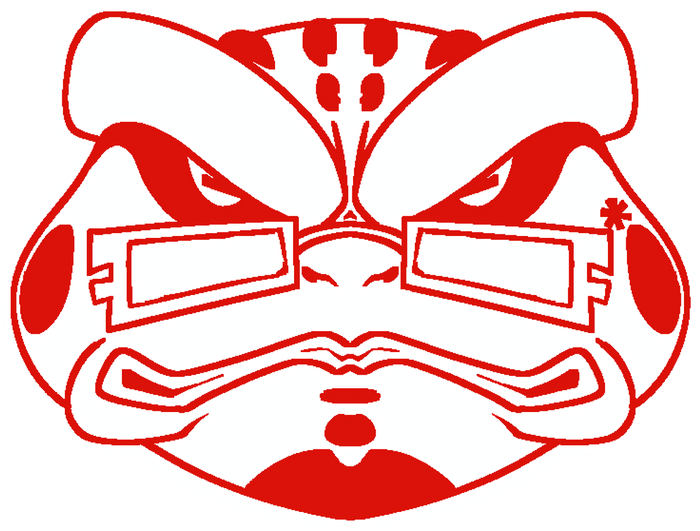

<div align="center">
  

  # FLAMMY™

  **Criatividade que ascende Tecnologia.**

  Website institucional da **Flammy**, uma software house que transforma ideias e necessidades de negócios em soluções digitais acessíveis, criativas e sob medida.

  
  
  
</div>

---

## Sobre o projeto

Este repositório contém o código-fonte do **site institucional da Flammy**, desenvolvido para apresentar nossa identidade, serviços, público-alvo e formas de contato.

A Flammy nasceu com a proposta de aproximar pessoas e tecnologia, oferecendo soluções que simplificam processos, conectam ferramentas e acompanham o crescimento de cada negócio.

## Funcionalidades

- **Layout responsivo:** navegação adaptada a diferentes tamanhos de tela.
- **Catálogo de serviços:** apresentação e filtragem por categorias.
- **Contato via WhatsApp:** links com mensagens pré-preenchidas para facilitar o primeiro contato.
- **Menu mobile:** navegação otimizada para dispositivos móveis.
- **Interações visuais:** animações de entrada, efeitos no cabeçalho e componentes interativos.
- **Apresentação da equipe:** seção dedicada às pessoas por trás da Flammy.
- **Informações comerciais:** público-alvo, nichos atendidos e formas de pagamento.
- **Acessibilidade:** suporte à preferência por movimento reduzido em animações.

## Nossos serviços

| Serviço | Descrição |
| --- | --- |
| Sistemas Web | Soluções personalizadas para a operação de negócios. |
| Aplicações Digitais | Ferramentas digitais pensadas para necessidades específicas. |
| Automação de Processos | Redução de tarefas manuais e repetitivas. |
| Integração de Ferramentas | Conexão entre sistemas e fluxos de informação. |
| Sites e Presença Digital | Desenvolvimento de presença profissional na internet. |
| Suporte e Evolução | Acompanhamento e melhoria contínua de soluções digitais. |

## Tecnologias utilizadas

O website foi desenvolvido com tecnologias web nativas, sem necessidade de framework ou processo de compilação:

- **HTML5:** estrutura e conteúdo.
- **CSS3:** identidade visual, responsividade e animações.
- **JavaScript (Vanilla JS):** navegação, filtros e interações.

## Estrutura do repositório

```text
Website-Flammy/
├── images/
│   ├── equipe/
│   ├── logo.png
│   └── ...
├── index.html
├── style.css
├── script.js
└── README.md
```

## Como executar localmente

1. Clone o repositório:

   ```bash
   git clone https://github.com/SEU-USUARIO/Website-Flammy.git
   ```

2. Entre na pasta:

   ```bash
   cd Website-Flammy
   ```

3. Abra o arquivo `index.html` no navegador. Alternativamente, use a extensão **Live Server** do VS Code.

> **Importante:** antes de publicar o site, substitua o número de exemplo em `script.js`, na configuração `FLAMMY.whatsapp`, pelo número oficial de contato com DDI e DDD, usando apenas dígitos.

## Público-alvo

Atendemos negócios recém-criados, empreendedores, pequenas empresas e negócios em crescimento que desejam modernizar operações e aproveitar melhor a tecnologia.

## Status

**Em desenvolvimento e evolução contínua.** Novos ajustes de conteúdo, identidade visual e experiência de navegação podem ser incorporados ao projeto.

## 🚧 Pendências e próximas implementações

> [!IMPORTANT]
> **Itens ainda não concluídos.** Esta seção reúne as prioridades de conteúdo, comunicação e expansão do website da Flammy. Marque cada tarefa quando estiver implementada e revisada.

- [ ] **Mensagem de divulgação via WhatsApp (estilo newsletter):** elaborar e revisar o texto da mensagem de notificação/divulgação, incluindo um **link clicável para o site ou catálogo da Flammy**. Validar linguagem, chamada para ação e destino do link antes do envio.
- [ ] **Apresentações individuais no site:** adicionar uma apresentação **profissional e acadêmica de cada integrante**, com informações padronizadas e revisadas pela equipe.
- [ ] **Serviços de inteligência artificial:** estruturar e incluir **soluções de IA como produtos/serviços da Flammy**, definindo escopo, benefícios e forma de contratação.
- [ ] **Atualização do WhatsApp:** substituir o contato atual pelo **número oficial da Flammy**, conferindo todos os botões, links e mensagens pré-preenchidas.
- [ ] **Integrantes da equipe:** cadastrar os integrantes que ainda não aparecem no site, com nomes, funções e informações autorizadas.

## Contribuições

Este é um projeto institucional da Flammy. Sugestões e relatos de problemas podem ser registrados por meio das *Issues* do repositório.

---

<div align="center">
  <strong>FLAMMY™</strong><br />
  <em>Criatividade que ascende Tecnologia.</em>
</div>
